# AtollCare

**AI-assisted emergency referral from remote communities to the hospital that can actually treat the patient.**

In many low-income and geographically isolated regions, the nearest health centre is small and under-resourced, and specialist care sits in a distant capital hospital. AtollCare connects these three moments into a single, continuous flow:

1. reaching the local health centre,
2. agreeing a referral with the capital hospital,
3. moving the patient there.

Information is captured once, travels with the patient, and is never lost at a hand-off.

---

## The problem

When someone falls acutely ill (for example, an elderly person with a stroke), whoever is nearby (family, a neighbour, a bystander) brings them to the local health centre. From there, the usual process is slow and fragile:

- **Information is re-collected at every step.** The person accompanying the patient explains what happened, ER staff check the patient's ID, the triage nurse asks again, and then a referral form asks again.
- **Finding the right specialist is a phone tree.** The local centre calls the capital hospital's switchboard, waits for a contact, then messages the doctor in charge.
- **Decisions are invisible.** A referral can be declined (for example, because the patient is elderly) with no recorded reason, no escalation, and no next step.
- **Paperwork comes last.** Transfer forms are filled in only *after* the patient is accepted, which delays dispatch.
- **The receiving team is blind.** The capital hospital learns little about the patient until they physically arrive.
- **Dead ends are common.** If the local centre lacks resources or expertise, the patient may simply be sent home.

In time-critical conditions such as stroke, heart attack or trauma, every one of these delays costs outcomes.

---

## How it fits together

AtollCare is split into three parts that share a single **Case Record**, identified by a case ID. Each part *adds* to the record, and no part re-asks for what is already there.

```mermaid
flowchart LR
    A[Patient becomes unwell] --> P1

    subgraph P1[Part 1 · Pre-arrival]
        direction TB
        P1a[Face scan → vital cues]
        P1b[Companion voice → instructions]
        P1c[ID scan → patient details]
    end

    P1 -->|Pre-arrival packet| P2

    subgraph P2[Part 2 · Health centre ↔ Capital hospital]
        direction TB
        P2a[Auto-drafted referral]
        P2b[Route to right specialist]
        P2c[Recorded decision]
    end

    P2 -->|Dispatch request| P3

    subgraph P3[Part 3 · Transport to capital]
        direction TB
        P3a[In-transit face scan]
        P3b[Nurse voice → reasoning summary]
        P3c[Sensor vitals → interpretation]
    end

    P3 -->|Live updates| H[Capital hospital ready on arrival]

    CR[(Shared Case Record)]
    P1 -.-> CR
    P2 -.-> CR
    P3 -.-> CR
    CR -.-> H
```



---

## Part 1: Pre-arrival at the local health centre
**Owner: Percy**

Goal: by the time the patient reaches the health centre, staff already know who the patient is, what is wrong, and what to prepare.

| Input | Action | Output |
|---|---|---|
| Video of the patient | Scan the face | Vital cues and supplementary observations |
| Voice of the person accompanying the patient | They describe what they see and what they need | Instructions and feedback to the companion, plus supplementary observations |
| Image of the patient's ID | Scan the details | Prompts that help the local health centre get help ready |

**Hands off:** a **pre-arrival packet** (identity, early vital cues, observations, companion's account) sent to the health centre before the patient walks in. The ID and slot check is done in advance.

### Running the Part 1 prototype

**What exists so far**

| Built | Not built yet |
|---|---|
| Face video → heart rate and breathing rate, with a quality score ([Presage SmartSpectra](https://smartspectra.presagetech.com)) | Neurological cues (face asymmetry, gaze) |
| Companion's voice → text, from the microphone or an uploaded audio file (Gemini 3.8 Flash) | Turning the transcript into observations and instructions for the companion |
| ID photo → name, ID number and age (Gemini vision). Unclear fields stay blank and the card is flagged "needs review" | Insurance check (an ID card does not say) |
| A demo web page that records and logs every trial | |

**What you need**

| Need | Notes |
|---|---|
| Python 3.13 | What it was built and tested on |
| Node.js 20 or later | Presage's SDK only exists for Node. It can live inside your virtual environment (see step 3) |
| A Presage API key | Free, from [physiology.presagetech.com](https://physiology.presagetech.com) |
| A Gemini API key | An AI Studio key, or a Google Cloud / Agent Platform key. Optional: without one the voice part runs in mock mode |
| A browser and a microphone | For the demo page |

Presage's SDK supports Windows x64, Linux x64 and ARM64 (glibc 2.35 or newer) and Apple Silicon Macs.

**Do not share the `.venv` folder.** It holds machine-specific paths and binaries, is several hundred MB, and is git-ignored. Everyone builds their own from [requirements.txt](requirements.txt). Likewise, never commit `inputs/.env`, which holds your keys.

**Setup (Windows PowerShell; on Mac/Linux use `source .venv/bin/activate`)**

```powershell
# 1. Python environment and packages
python -m venv .venv
.\.venv\Scripts\Activate.ps1
pip install -r requirements.txt

# 2. Your keys: copy the template, then open inputs\.env and fill it in
mkdir inputs
copy env.example inputs\.env

# 3. Node.js inside the same environment (skip if you installed Node 20+ yourself)
nodeenv -p -n 24.11.0

# 4. The Presage SDK
cd presage-sidecar
npm install
cd ..
```

If `nodeenv` fails on Windows, install Node 24 LTS from [nodejs.org](https://nodejs.org) instead. Re-run the activate line in each new terminal.

**What goes in `inputs/.env`** (everything is configured here and nowhere in the code; restart after editing)

| Line | Meaning |
|---|---|
| `PRESAGE_API_KEY` | Your Presage key. `PRESAGE_MODE=mock` gives fake numbers with no key |
| `GEMINI_API_KEY` | Your Gemini key. Leave blank for mock voice |
| `GEMINI_USE_ENTERPRISE` | **Which kind of Gemini key you have.** `false` for a Google AI Studio key (starts with `AIza`), `true` for a Google Cloud / Gemini Agent Platform (Vertex AI) key. Teammates with different keys each set their own. An enterprise key's API restrictions must allow the Vertex AI / Agent Platform API, otherwise Google answers `API_KEY_SERVICE_BLOCKED` |
| `GEMINI_STT_MODEL` | Speech model, currently `gemini-3.8-flash`. A model with `live` in its name streams as you speak, but Google refuses it for express-mode API keys at the moment |
| `GEMINI_STT_FALLBACK_MODEL` | Optional backup model if the main one cannot start |
| `GEMINI_ID_MODEL` | Vision model that reads ID photos, currently `gemini-3.8-flash` |
| `GEMINI_CHAT_MODEL`, `TRANSCRIBE_LANGUAGE`, `STT_*` | Chat model, language, and timing settings |
| `SAVE_RECORDINGS` | `true` keeps every voice, upload and video trial in `recordings/` for replay |

**Run**

```powershell
python run.py --serve          # demo page at http://127.0.0.1:8000 (on Windows you can double-click start.bat)
python run.py clip.mp4         # analyse one video from the command line
python run.py --mock           # try everything with no keys
python transcribe_file.py note.m4a   # transcribe an audio file
python scan_id.py card.jpg     # read the name and ID number from a photo of an ID
python -m pytest               # tests (no keys needed, nothing is sent to Google)
```

The page only works while that command is running. `run.py` starts the Presage sidecar for you.

**Filming tips.** Presage needs 45 to 60 seconds with the phone propped still, the patient quiet and facing the camera, the face and upper chest in frame, and steady light on the face. Talking invalidates the breathing rate. It plays the video in real time, so a one-minute clip takes one to two minutes to analyse. Phone videos are shrunk automatically before analysis.

**Where results go.** `logs/results.json`, `logs/transcripts.json`, `logs/id_scans.json` and `recordings/` hold your trials. They contain faces, voices and ID details, so they are git-ignored. Do not share them, and test with specimen or fake ID cards, not real ones. Photos you scan are sent to Google's Gemini service using your key.

---

## Part 2: Coordination between the health centre and the capital hospital
**Owner: [you]** · *Proposed design, open for team discussion*

Goal: turn "call around until someone says yes" into a fast, recorded, accountable referral.

| Input | Action | Output |
|---|---|---|
| Pre-arrival packet + local triage notes | AI drafts a structured referral (SBAR: Situation, Background, Assessment, Recommendation) and pre-fills the transfer form | A referral ready to send *before* the capital hospital is contacted, with no late form-filling |
| Patient condition, urgency, and the capital hospital's on-call roster | Route automatically to the right specialist | The doctor in charge is contacted directly with the full referral attached, with no switchboard phone tree |
| Doctor's response (accept / decline / need more info / remote advice) | Record the decision and its reason. If declined, trigger escalation or a second opinion instead of taking no action | An auditable decision. On accept, a **dispatch request** goes to transport (Part 3) |
| The local centre has the facility but lacks the expertise | Open a teleconsult with the capital specialist, sharing the case | Remote advice or guided intervention, logged to the case |
| The local centre lacks the resources | Suggest the nearest alternative facility, or a teleconsult, before sending the patient home | Fewer patients sent home with no plan |

**Hands off:** an accepted referral plus a dispatch request (destination, receiving doctor, urgency, transport type) to Part 3.

---

## Part 3: Transport to the capital hospital
**Owner: Ray**

Goal: the receiving doctor reads the patient's story and live condition *before* the vehicle (ambulance, boat or aircraft) arrives. Think of delivery tracking, but for hospitals.

| Input | Action | Output |
|---|---|---|
| Camera footage inside the ambulance | Scan the face | Vital cues and supplementary observations |
| Nurse's actions | (i) The nurse speaks to the AI; (ii) the AI detects and logs actions | A summary of the nurse's reasoning for the doctor |
| Sensor vitals | (i) Summarise (e.g. heart rate, heart-rate variability); (ii) interpret them as health signals | A briefing the doctor reads before the ambulance arrives |

**Hands off:** live case updates and an arrival briefing for the capital hospital team.

---

## Hand-off contract: the shared Case Record

| Field | Written by | Read by |
|---|---|---|
| Case ID, patient identity (from ID scan) | Part 1 | Parts 2, 3, capital hospital |
| Early vital cues and observations | Part 1 | Parts 2, 3 |
| Companion's account | Part 1 | Part 2 |
| Local triage notes | Part 2 (health centre) | Part 2 (capital), Part 3 |
| Structured referral (SBAR) and transfer form | Part 2 | Capital hospital, Part 3 |
| Referral decision and reason | Part 2 | Health centre, audit |
| Dispatch request | Part 2 | Part 3 |
| In-transit vitals and interpretation | Part 3 | Capital hospital |
| Nurse reasoning summary | Part 3 | Capital hospital |

---

## End-to-end example

> An elderly woman in a remote village shows signs of a stroke. Her neighbour helps her to the local health centre.
>
> 1. **Part 1:** On the way, the neighbour films her face and describes what happened. AtollCare flags facial asymmetry, coaches the neighbour on what to do, and scans her ID. The health centre receives a pre-arrival packet and prepares for a suspected stroke.
> 2. **Part 2:** Triage confirms the centre has no stroke specialist. AtollCare drafts an SBAR referral, routes it straight to the on-call neurologist at the capital hospital, and records the acceptance. The transfer form is already complete, and a dispatch request goes out immediately.
> 3. **Part 3:** In the ambulance, the camera and sensors stream vitals, and the nurse narrates interventions. The neurologist reads a live briefing and has the stroke team ready when she arrives.

---

## Team

| Part | Scope | Owner |
|---|---|---|
| 1 | Pre-arrival at the local health centre | Percy |
| 2 | Health centre ↔ capital hospital coordination | [you] |
| 3 | Transport to the capital hospital | Ray |

## Status and next steps

- [ ] Agree on the Case Record schema (the hand-off contract above)
- [ ] Part 1 prototype: face scan, voice companion, ID scan
- [ ] Part 2 prototype: referral drafting, specialist routing, decision log
- [ ] Part 3 prototype: in-transit vitals, nurse voice summary
- [ ] Join the three parts into one end-to-end demo
